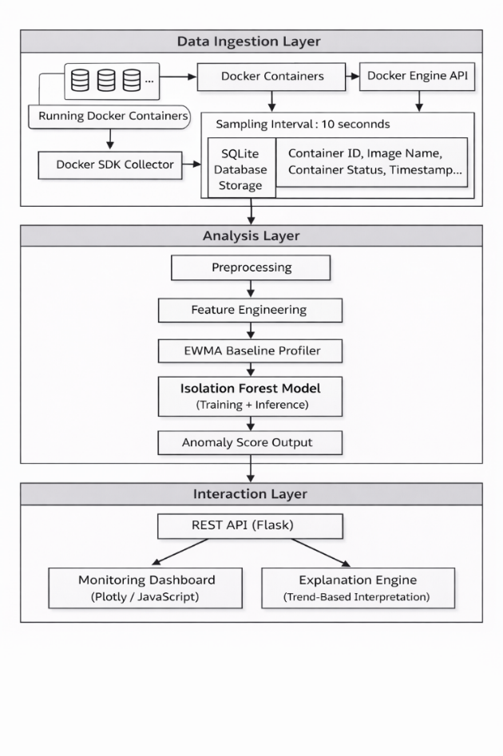

# AetherDock: Intelligent Container Health Monitoring and Anomaly Detection

       

AetherDock is an intelligent Docker container monitoring and anomaly detection system that continuously monitors the health of running containers, learns their normal behaviour using machine learning, and predicts abnormal container behaviour before failures become critical.

## Table of Contents

- [Research Publication](#research-publication)
- [Project Motivation](#project-motivation)
- [Features](#features)
- [System Architecture](#system-architecture)
- [Technology Stack](#technology-stack)
- [Project Workflow](#project-workflow)
- [Dataset Summary](#dataset-summary)
- [Data Collection Strategy](#data-collection-strategy)
- [Event Logging](#event-logging)
- [Collected Metrics](#collected-metrics)
- [Why the Model Was Trained Only on Normal Containers](#why-the-model-was-trained-only-on-normal-containers)
- [EWMA (Exponentially Weighted Moving Average)](#ewma-exponentially-weighted-moving-average)
- [Container Baseline Generation](#container-baseline-generation)
- [Feature Normalization](#feature-normalization)
- [Project Structure](#project-structure)
- [Installation](#installation)
- [Running the Collector](#running-the-collector)
- [Training the Model](#training-the-model)
- [Testing the Model](#testing-the-model)
- [Running the Flask API](#running-the-flask-api)
- [License](#license)
- [Acknowledgements](#acknowledgements)

Unlike traditional monitoring systems that rely on manually configured thresholds, AetherDock uses an unsupervised Isolation Forest model trained on normal container behaviour to identify anomalies automatically.

> **Note**
> This branch focuses on the backend implementation, data collection pipeline, feature engineering, machine learning model, and REST APIs.
> The frontend dashboard has been developed separately and is available in the project's main branch.

## Research Publication

This work was presented at the **1st International Conference on Innovation & Growth in Next-Gen Intelligent Technology & Engineering (IGNITE-2026)**. The research paper is now available in the **IEEE Xplore Digital Library**.

## Citation

[Read the published AetherDock research paper on IEEE Xplore](https://ieeexplore.ieee.org/document/11706034/). If you use this project, its methodology, dataset collection strategy, feature engineering pipeline, or anomaly detection framework in academic or research work, please cite the published paper.
---

## Project Motivation

Modern cloud-native applications consist of multiple Docker containers running simultaneously. These containers often experience failures such as:

- CPU spikes
- Memory leaks
- Network flooding
- Disk stress
- Crash loops

Traditional monitoring tools such as Prometheus, Grafana, and Docker Desktop primarily visualize resource usage and require manually configured alert thresholds.

AetherDock aims to solve this problem by automatically learning the normal behaviour of containers and detecting abnormal behaviour without manually specifying thresholds.

---

## Features

- Live Docker container monitoring
- Automatic metric collection every 10 seconds
- SQLite-based metric storage
- Dataset generation for model training
- Feature engineering using statistical and temporal features
- EWMA (Exponentially Weighted Moving Average) based smoothing
- Per-container baseline generation
- Feature normalization and scaling
- Isolation Forest based anomaly detection
- Live prediction API
- Container health explanation
- Designed for real-time integration with a monitoring dashboard

---

## System Architecture



---

## Technology Stack

| Component | Technology |
|-----------|------------|
| Programming Language | Python |
| Container Platform | Docker |
| Container Automation | Docker SDK for Python |
| Backend Framework | Flask |
| Local Database | SQLite |
| Machine Learning | Scikit-Learn |
| Feature Scaling | StandardScaler (Scikit-Learn) |
| Data Processing | Pandas, NumPy |
| Model | Isolation Forest |
| Visualization | Matplotlib |
| Version Control | Git & GitHub |

---

## Project Workflow

### Phase 1 — Data Collection

The first stage of the project involved collecting resource utilization metrics from running Docker containers.

A custom Python collector was developed using the Docker SDK.

Every 10 seconds, the collector records:

- CPU usage
- Memory usage
- Memory limit
- Network transmission
- Network reception
- Block read/write
- PID count
- Container status
- Timestamp

These metrics are stored inside an SQLite database.

### Phase 2 — Dataset Collection Methodology

Unlike many machine learning projects that rely on publicly available datasets, AetherDock uses a self-generated dataset collected from live Docker containers under both normal and anomalous operating conditions.

A custom data collection pipeline was developed to continuously monitor Docker containers and record their runtime metrics every 10 seconds. The collected metrics were stored in an SQLite database and later converted into CSV format for feature engineering and model training.

#### Containers Used

The following containers were used to represent healthy and faulty system behaviour:

| Container | Purpose |
|------------|---------|
| apache_server | Apache HTTP Server |
| nginx_server | Nginx Web Server |
| mysql-latest | MySQL Database |
| mysql-older | MySQL 8.0 |
| mongo | MongoDB |
| mongo-express | Mongo Express |
| postgres_db | PostgreSQL |
| redis_cache | Redis |
| memcached_cache | Memcached |
| influxdb_tsdb | InfluxDB |
| grafana_dash | Grafana Dashboard |
| elasticsearch_node | Elasticsearch |
| mem_bump | Gradual memory allocation workload |
| wonderful_joliot | Test Application |
| xenodochial_blackburn | Test Application |
| agitated_sammet | Test Application |
| boring_benz | Test Application |

| Container | Simulated Behaviour |
|------------|--------------------|
| cpu_burner | Continuous CPU saturation |
| cpu_load | Sustained CPU-intensive workload |
| cpu_burst_busybox | Short-duration CPU spikes |
| mem_leak | Continuous memory leak |
| net_flood | Excessive network traffic |
| disk_stress | Continuous disk read/write operations |
| crash_loop | Repeated container crashes and restarts |

### Phase 3 — Feature Engineering

Raw Docker metrics are transformed into statistical features suitable for machine learning.

The following features are generated:

- Mean CPU
- Maximum CPU
- CPU standard deviation
- CPU slope
- CPU deviation
- CPU z-score
- Mean memory
- Maximum memory
- Memory standard deviation
- Memory slope
- Memory deviation
- Memory z-score
- Average network receive
- Average network transmit

### Phase 4 — Model Training

AetherDock uses the Isolation Forest algorithm for anomaly detection.

The training process consists of:

1. Loading collected metrics
2. Filtering only normal containers
3. Feature engineering
4. Baseline generation
5. EWMA computation
6. Feature normalization
7. Isolation Forest training
8. Model serialization

Generated model files include:

```text
models/
├── isolation_forest.pkl
├── scaler.pkl
├── feature_cols.pkl
└── container_stats_baseline.csv
```

### Phase 5 — Live Prediction

For every running Docker container:

1. Docker metrics are collected
2. Recent samples are maintained
3. EWMA is computed
4. Statistical features are generated
5. Features are normalized
6. Isolation Forest predicts an anomaly score
7. The API returns health status, anomaly score, confidence, trend, feature summary, and a human-readable explanation

---

## Dataset Summary

- Metric collection interval: 10 seconds
- Total collected samples: 6155
- Training feature vectors: 1747
- Normal containers monitored: 17
- Synthetic anomaly containers: 7
- Duration of controlled experiment: 3 hours

---

## Data Collection Strategy

To build a representative dataset, a controlled 3-hour experiment was conducted while the collector continuously recorded container metrics every 10 seconds.

The experiment consisted of four phases.

### Phase 1 — Normal Baseline (0–30 minutes)

All normal service containers were allowed to run under idle conditions.

Purpose:

- Learn normal CPU usage
- Learn normal memory usage
- Record baseline network activity
- Capture healthy container behaviour

The beginning and end of the baseline phase were recorded using the event logging utility.

### Phase 2 — Continuous CPU Stress (30–90 minutes)

The cpu_burner container was executed to generate sustained CPU utilisation.

This phase simulated scenarios such as:

- Infinite loops
- CPU-intensive computations
- Resource starvation

The collector continuously recorded the resulting CPU behaviour while the event logger marked the start and end timestamps.

### Phase 3 — Gradual Memory Growth (90–150 minutes)

The mem_bump container gradually allocated memory over time.

This simulated real-world memory leak scenarios where memory consumption continuously increases without being released.

Unlike sudden spikes, this phase generated a slowly increasing memory trend suitable for temporal anomaly detection.

### Phase 4 — CPU Burst Injection (150–180 minutes)

A BusyBox container was used to inject short 30-second CPU bursts every 10 minutes.

This phase simulated transient workload spikes that frequently occur in production environments.

These bursts helped the model distinguish between temporary fluctuations and persistent anomalies.

---

## Event Logging

Alongside metric collection, every experimental phase was manually labelled using the log_event.py utility.

Examples include:

- baseline_start
- baseline_end
- cpu_burner_start
- cpu_burner_end
- memory_leak_start
- memory_leak_end
- cpu_spike_injected
- experiment_end

These labels make the dataset easier to analyse and validate during model development.

---

## Collected Metrics

Every 10 seconds, the collector recorded the following runtime metrics for every active Docker container.

- Timestamp
- Container ID
- Container Name
- Image Name
- CPU utilisation (%)
- Memory usage
- Memory limit
- Memory utilisation (%)
- Network receive bytes
- Network transmit bytes
- Block read bytes
- Block write bytes
- Number of processes (PIDs)
- Container status
- Experiment ID
- Sampling interval

The resulting dataset formed the basis for feature engineering and machine learning model training.

---

## Why the Model Was Trained Only on Normal Containers

Isolation Forest is an unsupervised anomaly detection algorithm.

Instead of learning what anomalies look like, it learns what normal behaviour looks like.

During training:

- Only healthy containers were used.
- A baseline was generated for each container.
- Feature normalization was performed.
- EWMA-based smoothing was applied.
- Statistical features were extracted.
- The model learned the normal operating region.

During prediction, any container whose behaviour deviates significantly from the learned normal baseline is isolated by the model and classified as anomalous.

This approach allows the system to identify previously unseen failure patterns without requiring labelled anomaly data.

---

## EWMA (Exponentially Weighted Moving Average)

Instead of relying only on instantaneous resource utilization, EWMA is used to smooth noisy metric fluctuations.

EWMA helps capture long-term trends while reducing the effect of sudden spikes.

This improves anomaly detection by reducing false alarms.

---

## Container Baseline Generation

Each container behaves differently.

For example:

- MySQL normally consumes much more memory than Nginx.
- Redis uses significantly less CPU than MongoDB.

Therefore, instead of comparing all containers against a single global baseline, AetherDock computes an individual baseline for each container.

The baseline stores:

- Average CPU
- CPU standard deviation
- Average memory
- Memory standard deviation

This allows predictions to be made relative to each container's own normal behaviour.

---

## Feature Normalization

Different features have different scales.

Example:

```text
CPU      : 25%
Memory   : 450 MB
Network  : 0.2 MB
```

Without normalization, larger values dominate the model.

A StandardScaler is therefore used to normalize all features before training and prediction.

---

## Project Structure

```text
AetherDock
├── backend/
│   ├── api/                  # Flask APIs
│   ├── analysis/             # Model training & testing
│   └── collector/            # Docker metrics collector
├── models/                   # Trained models
├── data/                     # Dataset
├── requirements.txt
├── schema.sql
└── README.md
```

---

## Installation

Prerequisites:

```bash
docker --version
python --version
```

Clone the repository:

```bash
git clone <repository-url>
cd AetherDock
```

Create and activate a virtual environment:

```bash
python -m venv venv
venv\Scripts\activate
```

Install dependencies:

```bash
pip install -r requirements.txt
```

---

## Running the Collector

```bash
python backend/collector/collector.py
```

---

## Training the Model

```bash
python backend/analysis/train_isolation_forest_v2.py
```

---

## Testing the Model

```bash
python backend/analysis/test_isolation_forest.py
```

---

## Running the Flask API

```bash
python backend/api/app.py
```

---

## License

This project is developed for academic and research purposes.

---

## Acknowledgements

This project was developed as part of an undergraduate research initiative in the field of intelligent cloud-native systems and machine learning-based anomaly detection.
